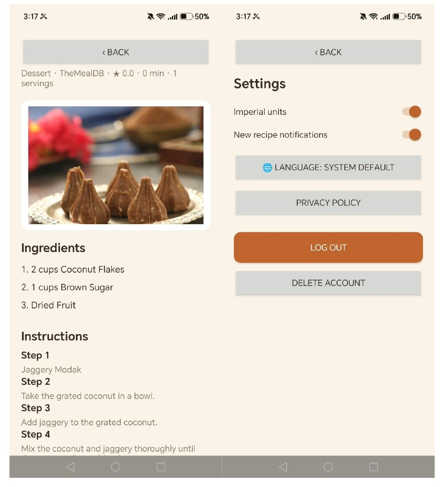
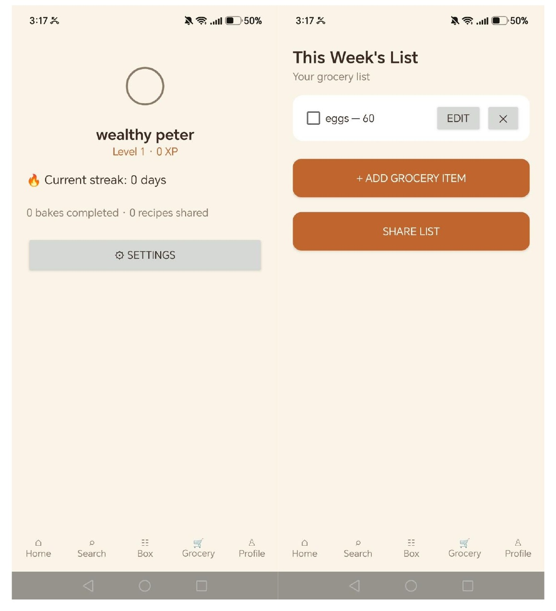
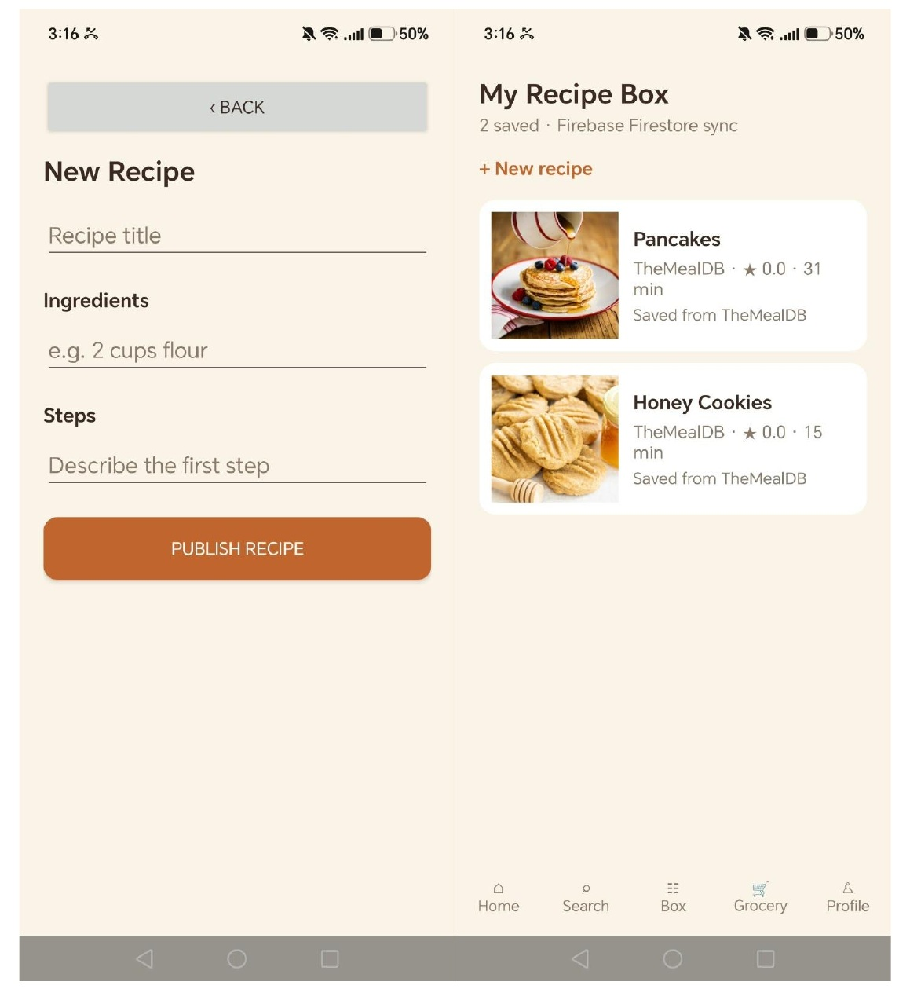
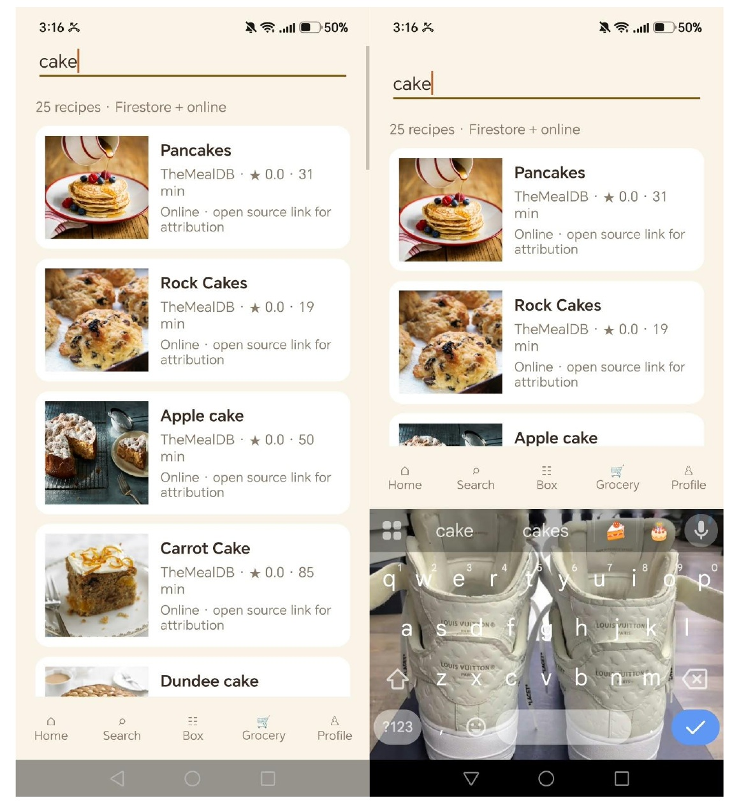
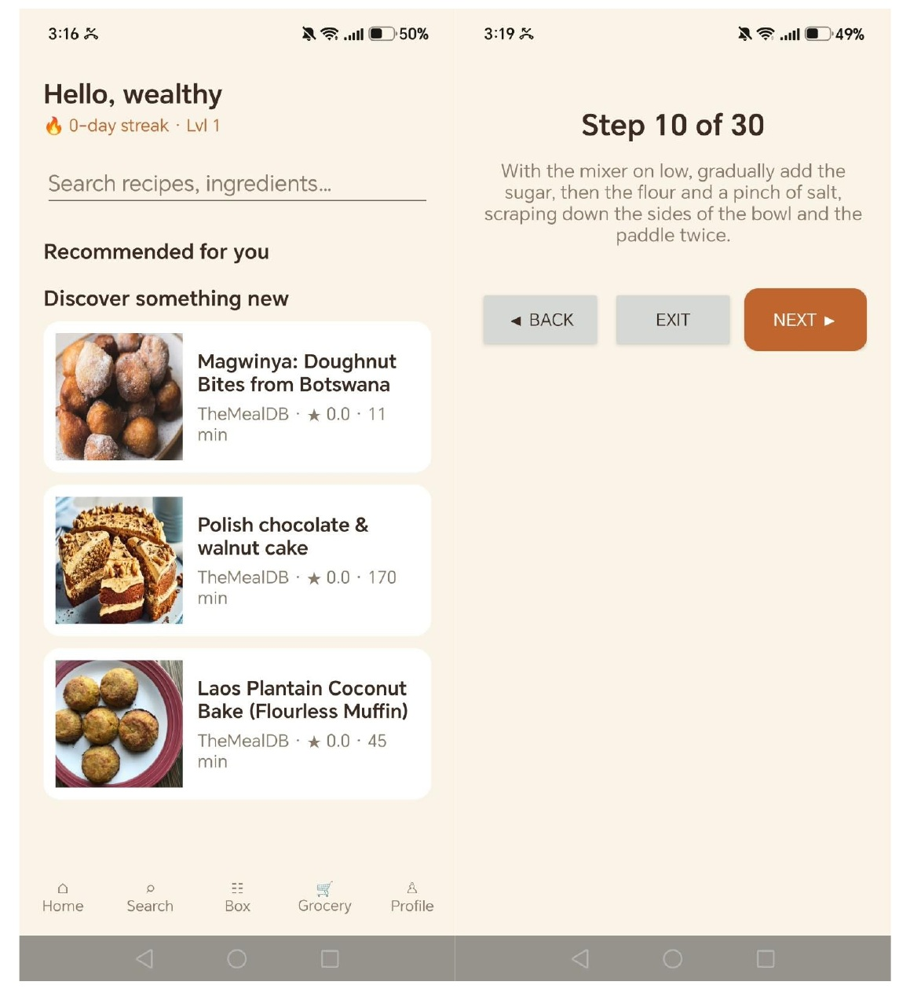

<div align="center">

# BakeHub

### A social baking companion for Android

**Discover recipes. Bake with confidence. Keep your kitchen organized.**

[](#technology-stack)
[](#technology-stack)
[](#system-design)
[](#release-notes)

[Watch the app demo](https://youtu.be/GvDeOrIa3E8?si=CNP0UkdVaPR7fKfj) · [Browse the source](https://github.com/galalelo/Bake_Hub)

</div>

---

## About BakeHub

BakeHub is an Android app for home bakers who want more than a collection of recipe links. It brings recipe discovery, recipe sharing, guided preparation and grocery planning into one mobile experience. A baker can find a recipe, save it, follow its instructions in **Bake Mode**, and keep the ingredients they need in a personal grocery list.

The project is designed around a practical kitchen workflow: clear step-by-step guidance, a timer for timed steps, a screen that stays awake during baking, and cloud-backed personal data that can remain useful when connectivity is interrupted.

| Project detail | Value |
|---|---|
| Application | BakeHub |
| Android package | `com.bakehub.app` |
| Current app version | `1.0.0` (`versionCode` 3 in Gradle) |
| Minimum Android version | Android 8.0 / API 26 |
| Primary users | Home bakers using an Android phone or tablet |
| Source repository | [github.com/galalelo/Bake_Hub](https://github.com/galalelo/Bake_Hub) |
| Demo | [Watch the BakeHub demo](https://youtu.be/GvDeOrIa3E8?si=CNP0UkdVaPR7fKfj) |

## What you can do

- **Find recipes:** Browse and search recipes stored in Firestore and recipes from TheMealDB. Online results retain their source links and attribution.
- **Make it yours:** Save recipes to the Recipe Box, publish your own recipes and report inappropriate user-generated content.
- **Bake step by step:** Use Bake Mode for ordered instructions and per-step countdown timers. The screen stays awake while you bake; timer completion can be announced by notification.
- **Plan shopping:** Add, edit, check off, delete and share grocery-list items. The list is associated with the signed-in user and synchronizes through Firestore.
- **Keep working offline:** Firestore persistence caches data locally and queues eligible writes for synchronization after reconnection. Previously opened external recipes are cached for offline access.
- **Stay up to date:** Firestore listeners refresh live content. A Cloud Function can send an FCM notification when a recipe is published; notifications can be turned off in Settings.
- **Use the app in your language:** Interface resources are provided in English, Spanish, French and Arabic, including right-to-left support for Arabic.
- **Manage your account:** Use email/password or Google sign-in, access the privacy policy and delete an account in the app.

## Screenshots

The screenshots below show representative app screens from the project demonstration material. They illustrate the interface; they do not, by themselves, indicate the result of an automated or end-to-end test.

<table>
  <tr>
    <td width="50%"><br><sub>Recipe detail and account settings</sub></td>
    <td width="50%"><br><sub>Profile and grocery list</sub></td>
  </tr>
  <tr>
    <td width="50%"><br><sub>Recipe publishing and Recipe Box</sub></td>
    <td width="50%"><br><sub>Recipe search</sub></td>
  </tr>
  <tr>
    <td width="50%"><br><sub>Home and guided Bake Mode</sub></td>
    <td width="50%"><strong>One connected baking journey</strong><br><sub>Discover a recipe, save it, prepare it step by step and manage the ingredients you need.</sub></td>
  </tr>
</table>

## Design considerations

BakeHub’s design decisions respond to the environment in which the app is used: a phone may be on a kitchen counter, the user may be following timed instructions, and the network may not always be reliable.

| Consideration | Design response |
|---|---|
| **In-kitchen usability** | A dedicated Bake Mode presents one ordered step at a time, provides timers and keeps the screen awake during the guided workflow. |
| **A joined-up workflow** | Recipe search, saved recipes, user publishing, Bake Mode and grocery planning are available in the same app. |
| **Unreliable connectivity** | Firestore disk persistence is configured with a 100 MB cache; previously opened external recipes are cached and queued writes can sync after reconnection. |
| **Personal data boundaries** | Firebase Authentication supplies user identity; Firestore rules are provided for user records and other collections. Grocery items are stored under the signed-in user. |
| **Trust and attribution** | External recipe results preserve their source links. Users can submit reports about inappropriate community content. |
| **Inclusive language support** | The interface contains English, Spanish, French and Arabic resources, with RTL presentation for Arabic. Recipe content itself is not automatically translated. |
| **User control** | Settings include notification preferences and privacy information; an in-app account deletion flow is provided. |
| **Maintainability** | Kotlin repositories separate authentication, user state, recipe data and external API access from the screen-routing layer. |

## System design

BakeHub is a native Android client backed by Firebase and an external recipe API. The Android layer owns the screens and user interactions; repository classes coordinate data access; Firebase provides authentication, cloud persistence and messaging; server-side functions handle selected event and search tasks.

```text
Android app (Kotlin + XML)
├── UI and navigation       MainActivity, screen routing, Android views
├── Data repositories       AuthRepository, UserRepository, RecipeRepository
├── External recipe client  Retrofit + TheMealDB models and mapping
├── Local support           Network monitor, recipe cache, locale/preferences
└── Notifications           FCM service, notification channels and preferences

Firebase
├── Authentication          Email/password and Google credential exchange
├── Cloud Firestore         Profiles, recipes, grocery items and reports
├── Cloud Messaging         Push notifications to opted-in users
└── Cloud Functions         New-recipe notification and optional recipe search proxy
```

**Technology stack:** Kotlin, Android XML views, Gradle, Firebase Authentication, Cloud Firestore, Firebase Cloud Messaging (FCM), Firebase Cloud Functions, Android Credential Manager, Retrofit and TheMealDB. The optional server-side external-search function uses Spoonacular; its API key belongs in Firebase secrets, not in the Android app.

## Repository layout

The Android project currently lives in the `BakeHub part 3/` folder of this repository.

```text
BakeHub part 3/
├── app/                         Android application and resources
├── functions/                   Firebase Cloud Functions
├── docs/                        AI-use statement, privacy policy, release checklist
├── firestore.rules              Firestore access rules
├── firestore.rules.test.js      Firestore emulator tests
├── .github/workflows/
│   ├── android.yml              CI workflow definition
│   └── release.yml              Release bundle workflow definition
└── gradlew                      Gradle wrapper

assets/readme/                   README screenshots
```

## GitHub and GitHub Actions

GitHub is the project’s shared source-of-truth: it stores the Android client, Firebase rules and functions, project documentation, workflow definitions and README screenshots. Commits preserve the change history and make it possible to review how the prototype evolved. Pull requests can be used to review changes before they are merged.

The repository contains two GitHub Actions workflow definitions:

- **Android CI** (`android.yml`) is configured for `push`, `pull_request` and manual `workflow_dispatch` events. It defines jobs for Android JVM unit tests, a debug APK build, Android lint, a release-bundle configuration build, Cloud Functions checks/tests and Firestore security-rule tests. The workflow uploads test reports, a debug APK and a lint report as artifacts where available.
- **Release bundle** (`release.yml`) is configured for version tags matching `v*` and manual dispatch. It restores an upload keystore from GitHub Actions secrets, runs unit tests, builds a signed Android App Bundle (`.aab`) and uploads the bundle as an artifact.

> **Workflow location check:** in the current repository tree these workflow files are under `BakeHub part 3/.github/workflows/`. GitHub Actions discovers workflows from the repository-root `.github/workflows/` directory. If the Actions tab shows no workflow runs, move the workflow files to that root-level location; the files currently document the intended pipelines but this README does not claim a successful run.

For a signed release workflow, configure these repository secrets under **Settings → Secrets and variables → Actions**: `BAKEHUB_KEYSTORE_BASE64`, `BAKEHUB_STORE_PASSWORD`, `BAKEHUB_KEY_ALIAS` and `BAKEHUB_KEY_PASSWORD`. Never commit a keystore, passwords, API keys or other private credentials.

## Getting started

### Requirements

- Android Studio (project README recommends Ladybug / 2024.2 or newer)
- JDK 17
- Android SDK for the project’s configured compile SDK
- Node.js 20 and npm for Cloud Functions and Firestore rule tests
- Firebase CLI if deploying Firebase rules or functions

### Open and run the Android app

1. Clone the repository and open the Android project folder, `BakeHub part 3/`, in Android Studio.
2. Create or select a Firebase project, add an Android app with package name `com.bakehub.app`, and place that project’s `google-services.json` in `BakeHub part 3/app/`.
3. In Firebase Authentication, enable **Email/Password** and **Google**. Create the Firestore database and deploy the project’s Firestore rules.
4. For Google sign-in, register the debug and release signing-certificate SHA-1 fingerprints in Firebase, then download a refreshed `google-services.json`. The installed build must use the matching Firebase project and OAuth configuration. Google sign-in also requires an Android device or emulator with a compatible Google credential provider.
5. Sync Gradle and run the `app` configuration on an Android 8.0+ device or emulator.

### Configure optional Firebase services

From the Android project directory:

```bash
cd "BakeHub part 3"
firebase deploy --only firestore:rules
```

Deploy Cloud Functions when they are needed. The optional Spoonacular search function requires a Firebase secret before deployment:

```bash
cd "BakeHub part 3/functions"
npm ci
cd ..
firebase functions:secrets:set SPOONACULAR_API_KEY
firebase deploy --only functions
```

Set the function region to match the Firebase project’s Firestore location. Do not place the Spoonacular key in the app or commit it to GitHub.

## Tests and quality checks

Run commands from the `BakeHub part 3/` directory.

| Check | Command | Coverage |
|---|---|---|
| Android JVM unit tests | `./gradlew testDebugUnitTest` | Recipe/API mapping, models, profile defaults, language tags and translation completeness. |
| Android lint | `./gradlew lintDebug` | Static Android checks. |
| Cloud Functions | `cd functions && npm ci && npm run check && npm test` | Function code checks and notification-message tests. |
| Firestore rules | `npm ci && npm run test:rules` | Rules for user data, grocery items, recipes, reports and FCM tokens against the emulator. |
| Debug APK | `./gradlew assembleDebug` | Builds the debug app. |
| Release bundle configuration | `./gradlew bundleRelease` | Builds the release bundle; without signing configuration it is not a signed Play upload. |

Test instructions and workflow files describe what is configured to run; check the repository’s **Actions** tab and downloaded artifacts for the actual result of a particular run.

## Release notes

### BakeHub 1.0.0 — prototype to current project version

The repository’s earlier prototype notes describe a Jetpack Compose interface, email/password Firebase authentication, Firestore-backed profiles and recipes, and recipe saving/publishing. The grocery list and some gamification data were still mock/static at that stage; external recipe search, recipe-image loading and several service integrations were not yet part of the described implementation.

This version extends that baseline as follows:

| Area | Prototype baseline | Added or upgraded in this version |
|---|---|---|
| **Android interface** | Jetpack Compose screen implementation. | Migrated to Kotlin/XML-based Android screens for onboarding, authentication, home, search, recipe box/detail, profile, grocery, settings, recipe creation and Bake Mode. |
| **Recipe discovery** | Firestore recipes and saved/published recipe flow. | Adds TheMealDB-backed discovery and search, external recipe/image mapping, source attribution and optional server-side Spoonacular search. |
| **Authentication** | Firebase email/password sign-up and login. | Adds Google single sign-on via Android Credential Manager and Firebase Auth; first-time Google users receive a Firestore profile. |
| **Grocery planning** | Static/mock grocery list. | Adds a per-user Firestore grocery list with add, edit, check-off, delete, share and cloud synchronization. |
| **Bake Mode** | Step navigation existed; progress/gamification updates were partly stubbed. | Upgrades the cooking flow with per-step countdown timers, screen-awake behavior and timer-completion notification. |
| **Offline use** | No complete offline recipe workflow documented. | Adds a 100 MB Firestore local cache, offline status, queued synchronization and a cache for previously opened external recipes. |
| **Live updates** | Core Firebase-backed data flows. | Adds Firestore listener-driven updates and an FCM notification flow for new recipe publications, with an opt-out preference. |
| **Languages** | No completed multilingual UI documented. | Adds English, Spanish, French and Arabic interface resources, including RTL layout support. |
| **Community safety and account control** | Basic user/profile and recipe flows. | Adds inappropriate-content reporting, an in-app account-deletion flow and privacy-policy access. |
| **Quality and release workflow** | No complete CI/release pipeline documented in the prototype notes. | Adds JVM, Cloud Functions and Firestore-rules test suites, lint/build jobs, GitHub Actions workflow definitions and a signed `.aab` release workflow. |

**Innovative features highlighted in this version:** Bake Mode timers designed for hands-busy cooking; an integrated personal grocery list synchronized through Firestore; offline access to cached content; combined community and external recipe discovery with source attribution; and opt-in real-time recipe notifications.

**Versioning note:** `1.0.0` and `versionCode 3` come from the Android Gradle configuration. The repository history does not contain a Git tag or published GitHub Release for this version; this section records the project’s prototype-to-current feature changes and is not evidence that an app-store release has shipped.

## Known limitations and next steps

- XP, levels, streaks, badges and the Weekly Challenge still use sample data.
- Recipe ownership rules currently rely on `authorName`; using and validating an `authorUid` would provide a stronger ownership check.
- The app interface is localized, but external and user-created recipe content remains in its original language.
- The Metric/Imperial preference is stored but is not yet applied to ingredient quantities.
- Firebase, OAuth, signing, secrets, notification delivery and release readiness depend on deployment-specific configuration and testing.
- Workflow files should be located at the repository root under `.github/workflows/` for GitHub Actions discovery.

See [`BakeHub part 3/docs/RELEASE_CHECKLIST.md`](BakeHub%20part%203/docs/RELEASE_CHECKLIST.md) for remaining Play Store tasks, [`BakeHub part 3/docs/PRIVACY_POLICY.md`](BakeHub%20part%203/docs/PRIVACY_POLICY.md) for the project privacy policy, and [`BakeHub part 3/docs/AI_USE.md`](BakeHub%20part%203/docs/AI_USE.md) for the project’s AI-use disclosure.

## Credits

Recipe data and images from [TheMealDB](https://www.themealdb.com). Search results preserve source links and attribution. Optional Spoonacular search is mediated through a server-side Cloud Function so its API key is not shipped in the Android application.
